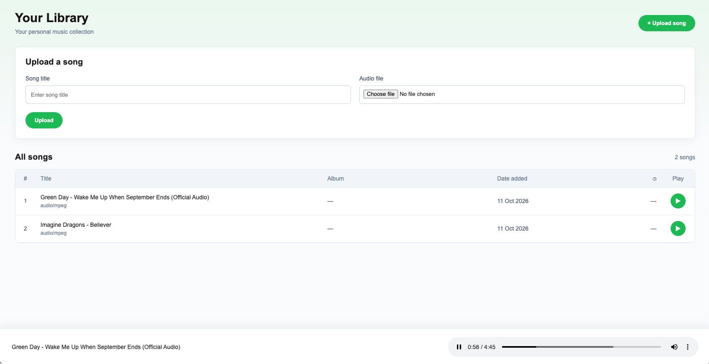
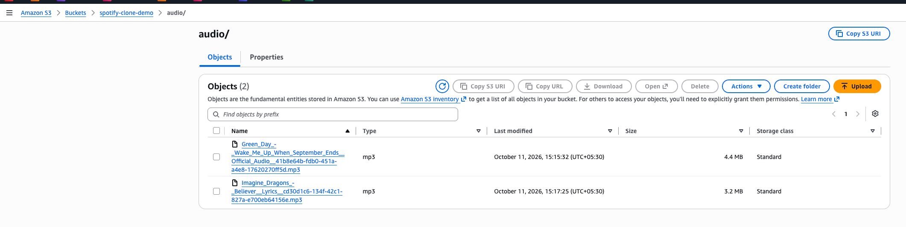
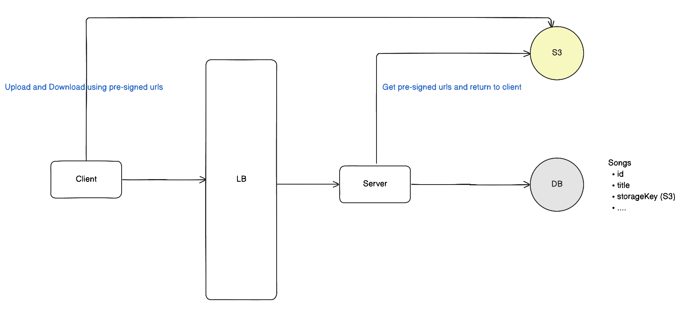
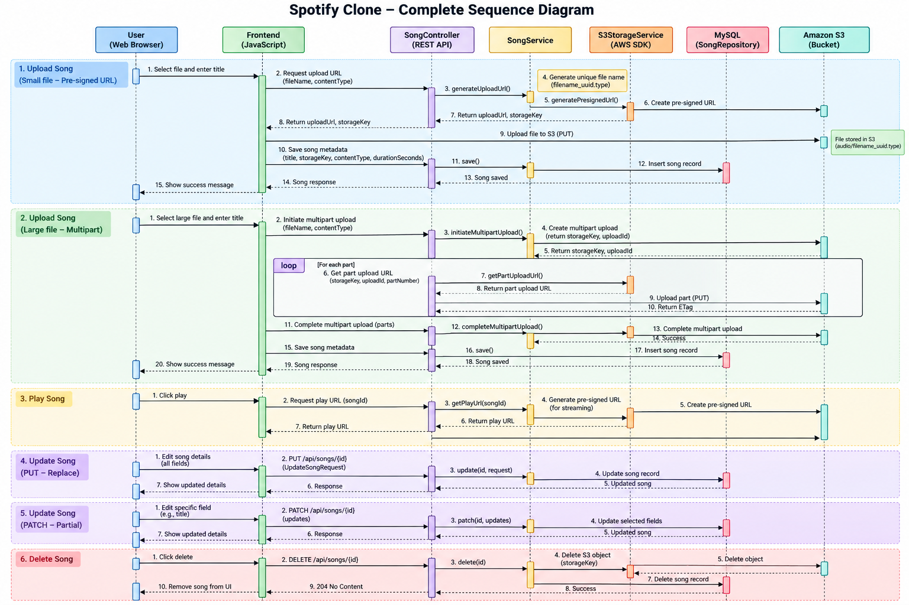

### About
- This is a simple Spotify clone built with Spring Boot.
- User can upload songs which are stored to S3
- User can then play the songs

### Optimizations

- For songs > 5 mb we use multipart upload to s3

### Home page - Upload and Play

### Songs are stored on S3 after upload

### Application UIs
- Home page: http://localhost:8080/
- Swagger UI: [http://localhost:8080/swagger-ui/index.html](http://localhost:8080/swagger-ui/index.html)

### High Level Design

### Complete Sequence Diagram

### Future enhancements
- Add search songs using elasticsearch
- Elasticsearch should be auto updated on song upload using CDC (Change Data Capture)

